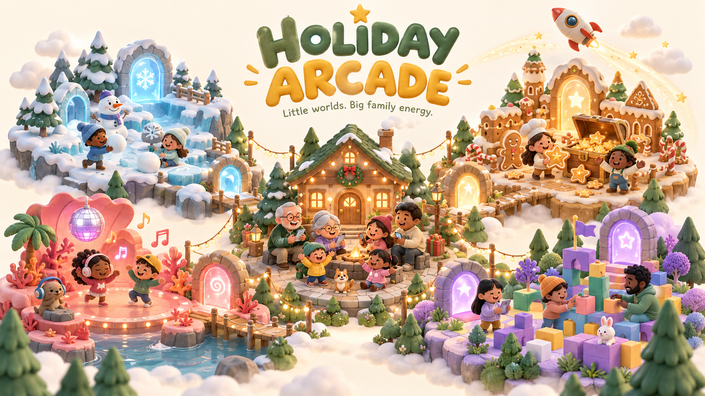
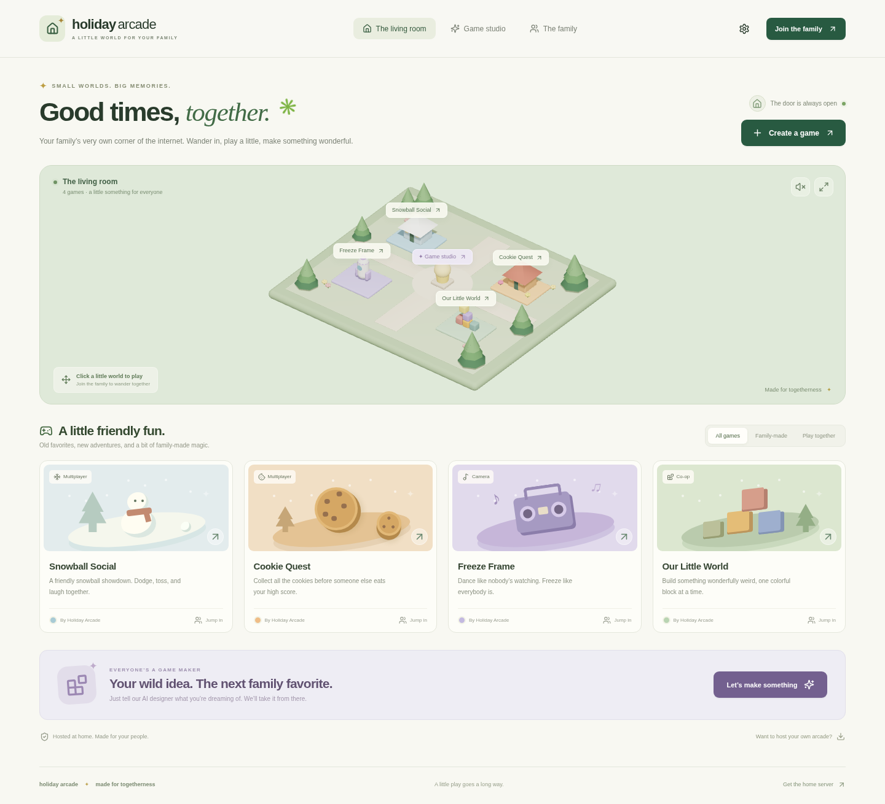

<p align="center">
  
</p>

<h1 align="center">Holiday Arcade ✦</h1>

<p align="center"><strong>Little worlds. Big family energy.</strong><br />Your computer hosts the party. Your family brings the imagination.</p>

<p align="center">
  <a href="#open-the-doors">Start the arcade</a> ·
  <a href="#your-weird-idea-is-the-next-game">Make a game</a> ·
  <a href="#take-the-arcade-home">Download the server</a> ·
  <a href="skills/create-family-game/SKILL.md">Game-making skill</a>
</p>

Imagine your cousin's cookie heist, Grandma's dance floor, and the ridiculously elaborate block castle someone has been building all afternoon. All in one little arcade. Everyone joins from their phone, puts a photo on a tiny character, and wanders into a game together.

**Holiday Arcade is a home-hosted multiplayer playground with an AI game studio.** Run one server, share a URL and invite code, and let every family member become a game maker. Describe an idea, let the AI build it in the background, and keep playing until the new world lands on the shelf.

This is a working first version: a Three.js hub, four starter games, shared rooms and chat, photo avatars, a portable home server, and an OpenAI-compatible game designer. You can try everything in demo mode before connecting a provider.

## The living room



*Actual app screenshot. The cover illustration above is generated concept art.*

| Walk into… | Bring your people for… |
| --- | --- |
| ❄️ **Snowball Social** | A friendly snowball showdown with server-simulated projectiles and hits. |
| 🍪 **Cookie Quest** | A collection race. Grab cookies, chase the high score, start another round. |
| 🎵 **Freeze Frame** | Camera freeze dance: dance on green, freeze on red. Video stays on your device. |
| 🧱 **Our Little World** | A shared building world. Stack colorful blocks and leave something for next time. |
| ✨ **Your family's next game** | An AI-written Three.js game with shared movement, events, saved state, and friendly scores. |

Players use **WASD / arrow keys** on a computer or the **joystick** on a phone. Click a portal or a game card to enter a room. Presence and room chat bring everyone together across the arcade.

## Open the doors

**Downloaded the home-server ZIP?** Unzip it and run the [one-time installer](#install-once-one-command-after-that). It handles Node.js, dependencies, and the start command for you.

Starting from this repository also works. If you already have **[Node.js 22.12 or newer](https://nodejs.org/)**:

```sh
git clone https://github.com/lalomorales22/holiday-games.git
cd holiday-games
npm ci
npm run build
npm start
```

Or clone the repository and run `bash Install-Linux.sh`, open `Install-Mac.command`, or open `Install-Windows.cmd`. The installer builds the website when starting from source, and starts the installed arcade after setup. With Node already installed, `npm run install:app` installs without starting it.

The terminal prints the host's local and Wi-Fi addresses, the **family invite code**, and a **host password** on first launch. Save the password; it unlocks settings. Open the dashboard on the host, then give everyone the Wi-Fi address and invite code.

1. Keep the computer awake and the terminal open.
2. Have players join the same Wi-Fi network. Allow the server through the host's local firewall if prompted.
3. Choose a name, optionally add a photo, and jump into a little world.

The Wi-Fi address works on that local network. For remote relatives and camera access on phones, use the [HTTPS setup below](#same-family-different-houses).

## Your weird idea is the next game

> “A treasure hunt in space, but the treasure is cookies and everyone is a tiny astronaut.”

Open **Game studio**, talk through the idea with the designer, and press **Build my game**. Go play something else while it builds. When it is ready, a notification appears and the game joins everyone's shelf.

The live designer can personalize a starter mechanic or write a custom Three.js browser game: mazes, treasure hunts, obstacle courses, and whatever your family dreams up within the game SDK. Custom games use procedural shapes and run in an isolated browser iframe. Generated JavaScript never runs on the home server.

**No key yet? Demo mode works immediately.** It chooses a starter mechanic and theme from the conversation. Live AI writes custom game code; demo mode uses the built-in engines. Each member can queue one build at a time, and the server bounds concurrent builds and AI calls.

### Give the designer an AI connection

Open the gear icon, sign in with the **host password**, and enter:

| Setting | Example |
| --- | --- |
| API URL | `https://api.openai.com/v1` or another compatible HTTPS provider |
| Model | `gpt-4o-mini` or a model your provider supports |
| API key | Your provider key, entered only in host settings |

Use the host's localhost address or an HTTPS connection when entering host credentials. Plain Wi-Fi HTTP does not encrypt traffic. Prompts go to your chosen provider and may incur usage charges; family photos and camera frames are not included in AI requests.

Saved API keys are encrypted with AES-GCM using a private local key file and are never returned to players. Keep both the data and key files private: encryption does not protect against someone with access to the host and both files. Put keys in host settings or a private `.env`, never game prompts or room chat.

<details>
<summary><strong>Environment settings, password recovery, and an optional local provider</strong></summary>

Copy `.env.example` to `.env` to set `HOLIDAY_AI_KEY`, `HOLIDAY_AI_URL`, and `HOLIDAY_AI_MODEL`. Environment values override the settings UI. `.env` and `.holiday-data/` are ignored by Git, and the application does not print the API key.

To recover a lost host password, stop the server, set `HOLIDAY_HOST_PASSWORD` in the private `.env`, and restart. This explicit override changes the saved password while preserving your family's games.

For a local OpenAI-compatible provider, Ollama can use `http://127.0.0.1:11434/v1`, the name of an installed chat model, and `ollama` as the key. Remote providers require HTTPS.

</details>

## Take the arcade home

```sh
npm run package
```

This builds **`downloads/holiday-arcade.zip`**, also available through **Get the home server** in the dashboard. The bundle includes the production app, server, lockfile, this README and artwork, game-making skill, examples, installers, and portable launchers. It excludes credentials, family data, photos, and installed dependencies.

### Install once, one command after that

Unzip the download and run:

| Computer | One-time setup |
| --- | --- |
| Windows | Open `Install-Windows.cmd` |
| macOS | Open `Install-Mac.command`, or run `bash Install-Mac.command` |
| Linux | Run `bash Install-Linux.sh` |

The installer reuses a compatible Node.js 22.12+ installation, or downloads a private **Node.js 24 LTS** runtime from nodejs.org and verifies its SHA-256 checksum. It installs all app dependencies and adds **`Holiday-arcade`** to your user PATH. No administrator access is required. Internet access is needed for this first setup.

The first setup starts the arcade. After that, **open a new terminal** and type:

```sh
Holiday-arcade
```

That starts the production website **and** Socket.IO / WebSocket multiplayer server in one process and opens your browser once ready. It works from any folder; the original ZIP and extracted download can be removed. Keep the terminal open while everyone plays. **Ctrl+C stops both servers.** The command starts the app manually; it does not install a background service or start at login.

| Installed files | Location |
| --- | --- |
| macOS / Linux | `~/.holiday-arcade/` |
| Windows | `%LOCALAPPDATA%\HolidayArcade\` |
| App files | `app/` inside that folder |
| Settings and saved family worlds | `.env` and `.holiday-data/` beside `app/` |

Set `PORT` and other environment settings in that installation's `.env`. Reinstalling replaces app files after setup succeeds and preserves the installed `.env` and `.holiday-data/`. Stop the running arcade before reinstalling. The installer creates a fresh household; it does not copy private family data or credentials from the downloaded folder or a source checkout.

On macOS / Linux, the installer adds a marked PATH block to bash and zsh startup files. On Windows it updates the current user's PATH. Existing unrelated startup content is preserved. For other shells, add the installation's `bin/` folder to PATH manually. If a terminal doesn't find the command, open a new terminal or run the printed command path directly.

For setup without starting the server, use `bash Install-Linux.sh --no-start`, `bash Install-Mac.command --no-start`, or `Install-Windows.cmd -NoStart`. Set `HOLIDAY_INSTALL_DIR` to an empty custom installation folder if needed. `Holiday-arcade --no-open` starts without opening a browser; `Holiday-arcade --help` shows usage.

### Portable launchers

You can also run the original `Start-Windows.cmd`, `Start-Mac.command`, or `bash Start-Linux.sh` in the extracted folder with Node.js 22.12+ already installed. These launch in place without installing a persistent command; keep that folder. First launch installs production dependencies. If macOS drops executable permissions, use `chmod +x Start-Mac.command` or run it with bash. With a custom `PORT` in `.env`, open the printed address manually; these portable launchers use the shell's `PORT` or 3000 for automatic browser opening.

The Linux installer and bundle have been exercised. Windows and macOS installers and launchers still need testing on those operating systems. A signed native installer and automatic updates are future work.

## Same family, different houses

**Phone cameras need HTTPS.** Cameras can be tested on the host at localhost. For remote family, one option is [Tailscale Serve](https://tailscale.com/kb/1312/serve): install Tailscale on the host and family devices, invite them to the private network, then:

```sh
tailscale serve --bg http://127.0.0.1:3000
```

Share its HTTPS address and your family invite code. This also enables camera games on phones. Tailscale is a separate setup step and has not been provisioned or verified by this repository.

A configured HTTPS reverse proxy with WebSocket support also works. Preserve the external `Host` header because the server checks request and socket origins. Do not expose the HTTP server through a router port forward.

## What's saved for next holiday?

Games, member profiles, photos, building blocks, and custom shared state live in **`.holiday-data/`** on the host: inside the installed folder for `Holiday-arcade`, or the project/extracted folder when using `npm start` or a portable launcher. Keep that folder and `.env` private when backing up. There is no database or cloud storage to provision; one Node process runs the arcade.

Active rounds, online presence, sessions, and build jobs reset when the server stops. Players rejoin with the invite code; interrupted builds must be submitted again. To start fresh, stop the server and back up or move `.holiday-data/`.

This version is sized for a family: up to **100 profiles, 100 games, and 300 blocks per building world**. Camera and custom-game scores trust the player's browser. Custom shared state uses last-write-wins updates. They suit friendly family games; competitive anti-cheat is outside this version.

AI-written games may need refinement or another attempt. Syntax validation catches broken JavaScript, but it does not prove the gameplay works. The sandbox blocks access to the host filesystem, host keys, parent app, external network requests, and cameras; custom games use procedural Three.js shapes without imports or external assets.

## For the family tinkerer

**React · Three.js · React Three Fiber · Express · Socket.IO**

```sh
npm ci
npm run dev          # Vite on 5173; server on 3000; HTTP + WebSocket proxy
npm test             # Real HTTP and multiplayer server integration
npm run test:browser # Build, then browser flows with two players and phone layouts
npm run package      # Build the portable home-server bundle
```

The tests use temporary data and a local mock AI provider, so they do not need or spend a real API key. Browser tests cover joining rooms, movement, chat, background creation, photo avatars, phone controls, synthetic camera input, and custom-game isolation. Live provider generation and a physical phone camera still need testing with your setup.

Playwright uses system Chromium when available. Otherwise run `npx playwright install chromium`, or set `PLAYWRIGHT_CHROMIUM_EXECUTABLE` to a Chromium executable.

| Want to change… | Start here |
| --- | --- |
| The living room and avatars | [src/World.jsx](src/World.jsx) |
| Dashboard and studio | [src/App.jsx](src/App.jsx) |
| Multiplayer mechanics | [server/world.js](server/world.js) and [server/games.js](server/games.js) |
| The AI designer | [server/ai.js](server/ai.js) |
| The custom-game SDK | [src/game-runtime.js](src/game-runtime.js) |
| A complete custom game | [examples/treasure-garden.js](examples/treasure-garden.js) |
| Game-making agent instructions | [skills/create-family-game/SKILL.md](skills/create-family-game/SKILL.md) |

Keep custom game code in the browser sandbox; do not execute generated JavaScript on the home server. Playing needs no third-party font or image service.

---

<p align="center">Made for “one more round,” improbable family lore, and something you built together. ✦</p>
